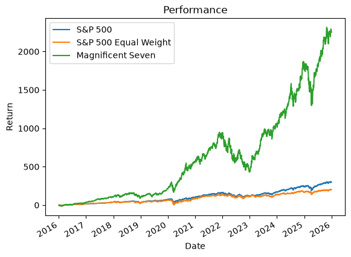

# Diversification in the S&P 500

Victor Miller · [GitHub](https://github.com/victor-mler) · [LinkedIn](https://www.linkedin.com/in/miller-victor)

In August 2026, SPY's holdings had the same weight concentration as an equally weighted portfolio of about 48 positions. Returns from 2016 to 2025 are compared across three portfolios:

- SPY, which tracks the cap-weighted S&P 500
- RSP, which tracks the S&P 500 Equal Weight Index (0.2% target weight per company at quarterly rebalancing)
- a simulated Magnificent Seven basket (Microsoft, Apple, Nvidia, Amazon, Alphabet, Meta and Tesla), rebalanced to equal weights daily

## Table of Contents

- [What the comparison covers](#what-the-comparison-covers)
- [Key results](#key-results)
- [What is inside](#what-is-inside)
- [Getting started](#getting-started)
- [Repository structure](#repository-structure)
- [Data and methodology notes](#data-and-methodology-notes)
- [License](#license)

## What the comparison covers

SPY and RSP hold the same constituents; only the weights differ. Comparing their returns over 2016–2025 describes what those weights produced. The seven-stock basket takes concentration further. The holdings snapshot answers a separate question, about the spread of SPY's weights on one date.

## Key results

The Herfindahl-Hirschman index of the SPY holdings is 208.92 on the 0–10,000 scale. The return statistics below use the earlier 2016–2025 sample.

| Metric | S&P 500 | Equal Weight | Magnificent Seven |
|---|---|---|---|
| Annualized volatility | 18.05% | 18.57% | 29.00% |
| Annualized Sharpe ratio | 0.74 | 0.57 | 1.16 |
| Compounded return over 10 years | +300.25% | +199.60% | +2251.74% |
| Maximum drawdown | -33.72% | -39.04% | -49.38% |

SPY had a higher Sharpe ratio than RSP over this period. The simulated basket had the highest compounded return and the deepest drawdown.



## What is inside

1. Data loading and preprocessing
2. Daily simple and log returns, portfolio synthesis
3. Historical and rolling volatility
4. Correlation matrix
5. Standardized moments, normality, Q-Q plot and Student t-fit
6. Sharpe and Sortino ratios, including rolling Sharpe
7. Cumulative performance and maximum drawdown
8. Herfindahl-Hirschman index and effective number of constituents
9. Conclusion

## Getting started

To rerun everything from scratch:

1. Install the dependencies:

   ```
   pip install -r requirements.txt
   ```

2. Get a free FRED API key and put it in a `.env` file:

   ```
   FRED_API_KEY=your_key
   ```

   See `.env.example`. The key is used for the risk-free rate (3-month T-bill, series DGS3MO). Price data is downloaded with `yfinance`.

3. Open the notebook and run all cells.

The holdings file used in section 8 lives in `data/raw/` and is a State Street SPDR snapshot dated August 25, 2026.

## Repository structure

```
sp500-concentration-analysis/
├── sp500-concentration-analysis.ipynb   # the full analysis
├── README.md
├── requirements.txt
├── .env.example                         # FRED API key template
├── .gitignore
├── figures/
│   └── performance.png                  # key chart used in this README
└── data/
    └── raw/
        └── holdings-daily-us-en-spy.xlsx  # SPDR SPY holdings, 2026-08-25
```

## Data and methodology notes

Returns are computed from Yahoo Finance's adjusted closing prices. The seven stocks were chosen in hindsight; the basket is a historical comparison, not a strategy selected in 2016. The simulation does not deduct trading costs.

The holdings snapshot postdates the return sample. The effective number of constituents measures the spread of weights, without accounting for volatility or correlations.

The risk-free rate comes from FRED (DGS3MO) and is only used to build daily excess returns for the Sharpe and Sortino ratios.

## License

[MIT](LICENSE.txt)